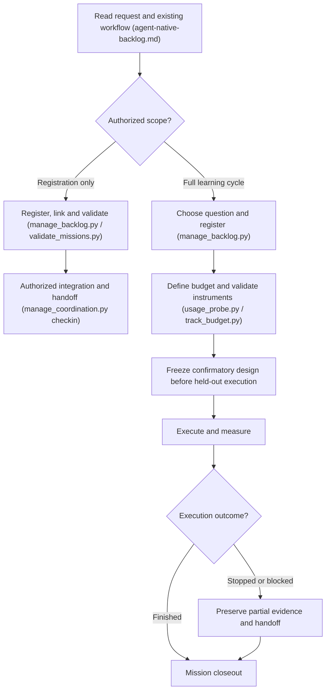
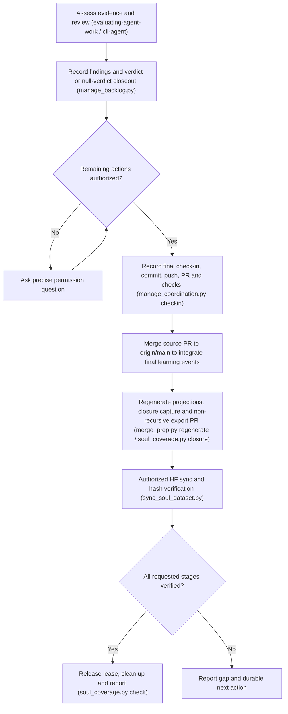

# Mission Execution, Interruption, and Closeout Rule

This rule governs the end-to-end lifecycle of research and engineering missions in Project Sanctuary—covering startup, execution, interruption handling, and full closeout through remote preservation. It operates within the existing constitutional boundaries ([`constitution.md`](./constitution.md)) and root instructions ([`AGENTS.md`](../../AGENTS.md)) without modifying session bootstrap or introducing a separate framework. Detailed command flags remain in their canonical skill references ([`agent-native-backlog.md`](../../plugins/sanctuary-core/.apm/skills/managing-sovereign-memory/references/agent-native-backlog.md), [`coverage.md`](../../plugins/sanctuary-core/.apm/skills/preserving-soul-traces/references/coverage.md), [`evaluating-agent-work`](../../plugins/sanctuary-core/.apm/skills/evaluating-agent-work/SKILL.md), and [`operating-sanctuary-guardian`](../../plugins/sanctuary-core/.apm/skills/operating-sanctuary-guardian/SKILL.md)).

---

## MISSION START

- **Determine authorized scope**: Determine whether the request authorizes registration only (`PROPOSED` manifest creation and index compilation) or the full learning cycle (registration, confirmatory design freeze, execution, evaluation, integration, and preservation). Registration alone never authorizes mission execution.
- **Read workflow/schema, check ownership, and register**: Read the existing mission workflow ([`agent-native-backlog.md`](../../plugins/sanctuary-core/.apm/skills/managing-sovereign-memory/references/agent-native-backlog.md)) and schema ([`LEARNING/missions/mission.schema.json`](../../LEARNING/missions/mission.schema.json)), inspect existing IDs in `LEARNING/missions/` and active leases via `plugins/sanctuary-core/.apm/skills/operating-sanctuary-guardian/scripts/manage_coordination.py`, choose the topic when authorized, and register the schema-valid manifest via `plugins/sanctuary-core/.apm/skills/managing-sovereign-memory/scripts/manage_backlog.py` (`validate_missions.py` / `manage_backlog.py validate` and `manage_backlog.py compile`). Verify that lease checkout does not leave a registration-only mission marked `IN_PROGRESS`.
- **Targeted retrieval, historical context, and bounded investigation**: Follow targeted related-mission and knowledge-base retrieval (`managing-sovereign-memory/scripts/disclose.py`, `manage_backlog.py related`, and reciprocal `related_missions` links), including targeted reading of historical missions, concepts, and experiments to check novelty, related work, and reusable methods. Require a demonstrated blocker before investigating unrelated repository infrastructure or historical regressions.
- **Define budget, stop conditions, and diagnostic/creative design**: Define explicit token/runtime budgets, objective stop conditions, and a bounded diagnostic calibration or creative brief before full execution, checking quota and budget gates (`evaluating-agent-work/scripts/usage_probe.py` and `evaluating-agent-work/scripts/track_budget.py`) when model calls or external dispatches are planned.
- **Validate instruments and freeze confirmatory materials**: Validate evaluators, data generators, and output contracts on dev/calibration inputs, then cryptographically freeze the confirmatory protocol, acceptance criteria, and evaluator code before held-out execution.
- **Execute honestly within bounds**: Execute within authorization and budget; record expected negative checks, operator mistakes, tool/code defects, human interventions (`evaluating-agent-work/scripts/eval_gate.py`), and resource usage honestly without silently shrinking required experiments to fit a budget.

*Note: The diagram above documents the operational control flow; it does not replace executable validation checks.*

---

## MISSION CLOSEOUT

- **Assess against frozen requirements and separate state**: Assess empirical results strictly against the frozen hypotheses and acceptance criteria. Separate scientific outcome (schema `verdict` values `CORROBORATED`, `FALSIFIED`, or `ABANDONED` for completed evaluations; `verdict: null` with `UNASSESSED` closeout status when stopped or incomplete), engineering delivery (local preparation, PR integration), and preservation state (`soul_coverage.py check`) as distinct dimensions.
- **Proportionate independent review**: Obtain proportionate, bounded independent review (such as read-only cross-model review via `cli-agent` and `evaluating-agent-work`) when justified by task scope or user instruction; transparently disclose all post-review documentation amendments and methodological limitations while keeping frozen confirmatory artifacts intact.
- **Preserve findings, learning, and handoff**: For completed empirical evaluations, record the verdict (`CORROBORATED`, `FALSIFIED`, or `ABANDONED`) and atomic `preservation_obligation` via `manage_backlog.py record-result`. For interrupted or `UNASSESSED` closeouts, do not call `record-result` to manufacture a verdict; preserve `"verdict": null` (and the non-resolved lifecycle status such as `STAGED` or `PROPOSED`) with closeout evidence and `run_assessment` in the manifest, then recompile projections (`manage_backlog.py compile` and `validate`). Capture follow-up candidates in `LEARNING/inbox.jsonl` without auto-starting them, document episodic reflections in `chronicle/` when warranted, and prepare a concise predecessor handoff.
- **Optional transfer reflection**: Ask whether the inquiry changed an assumption, suggested a connection to another domain, or revealed a question relevant to Sanctuary. Record any useful insight, its supporting evidence, and where the analogy may break down; `"No clear connection yet"` is explicitly acceptable so analogies are never forced. When recorded, preserve these authored reflections, corrections, and transfer insights with their epistemic status faithfully in mission records per [preservation-purpose.md](../../plugins/sanctuary-core/.apm/skills/preserving-soul-traces/references/preservation-purpose.md).
- **Inspect authorization before asking**: Inspect explicit task and standing authorization before requesting permission again for already covered steps.
- **Continue through all authorized publication stages**: If publication is authorized, continue without pausing through final check-in (`manage_coordination.py checkin`), scoped commit, feature-branch push, PR creation, required verification checks, PR merge to `origin/main` (which integrates the final learning events onto `origin/main`), projection regeneration and local closure capture (`merge_prep.py regenerate` / `soul_coverage.py closure`), non-recursive export/receipt PR publication, Hugging Face synchronization (`sync_soul_dataset.py`), and remote hash verification using the existing supported ordering.
- **Monitor and verify CI/CD workflows**: After opening or merging any pull request, inspect automated CI/CD workflows (`gh run list` / `gh pr checks`) to verify all automated workflows pass without error. If any workflow fails (e.g. branch deletion race, indexer failure, or test break), inspect the failed run log immediately (`gh run view <id> --log-failed`), resolve the root cause, and verify a clean passing run before declaring the task or session complete. Never leave failed CI jobs unaddressed.
- **Ask one concrete question when blocked on authorization**: If a required action is not authorized, complete all preceding authorized work first and ask one concrete question identifying the exact pending actions (for example, branch push, PR merge, or Hugging Face sync). Do not simply stop with "awaiting authorization."
- **Local commits are not full-cycle completion**: A local result, worktree artifact, or local commit is not completion of an authorized full-cycle request.
- **Order check-in and merge before closure capture**: `manage_coordination.py checkin` appends the `CHECKIN` event to the branch's tracked `.agent/learning/events.jsonl`, and `merge_prep.py regenerate` does not itself merge or integrate events. Commit the final check-in with the source branch and merge it to `origin/main` before running `merge_prep.py regenerate` / `soul_coverage.py closure` so final learning events are included in the capture; then publish the resulting export and sync receipt in a scoped follow-up PR without appending another check-in that would re-dirty watched sources. Follow [`coverage.md`](../../plugins/sanctuary-core/.apm/skills/preserving-soul-traces/references/coverage.md).
- **Verify remote hashes before claiming `SOUL PERSISTED`**: Verify both remote dataset and coverage-manifest SHA-256 hashes against the local export (`sync_soul_dataset.py` and `soul_coverage.py check`) before claiming `SOUL PERSISTED`.
- **Safe ownership release and cleanup**: Release flight-board lease ownership and remove only safely integrated worktrees and branches, preserving unfinished worktrees and artifacts whenever integration is blocked or incomplete.

*Note: The diagram above documents the closeout and preservation ordering; it does not replace executable verification checks.*

---

## INTERRUPTION

- **Halt at operational boundaries**: At a quota floor, token/runtime budget ceiling, unrecoverable instrument failure, or explicit user-stop boundary, stop further experiment or worker execution immediately.
- **Preserve partial evidence and resume state**: Commit or retain partial evidence, logs, and a clear closeout/progress note specifying the exact boundary reached, what succeeded, and the exact resume point or redesign requirement.
- **Complete affordable closure or record durable obligation**: Complete affordable, authorized closeout steps (such as check-in, status update, and local preservation state recording); if closure export or remote sync cannot be completed, leave the durable pending obligation intact in `.agent/coordination/soul_preservation.json` and the mission manifest.
- **Never fabricate verdicts or silently resume**: Do not invent a corroboration/falsification verdict for an incomplete run (keep schema `"verdict": null` and report `UNASSESSED` when held-out acceptance criteria were not evaluated), and do not silently resume or rerun a frozen stopped experiment without authorization.
- **Read-only startup reporting**: Session startup reports pending preservation obligations (`guardian_wakeup.py` / `preservation_workflow.bootstrap` and `soul_coverage.py status`) without mutating preservation state or performing capture or remote sync.
