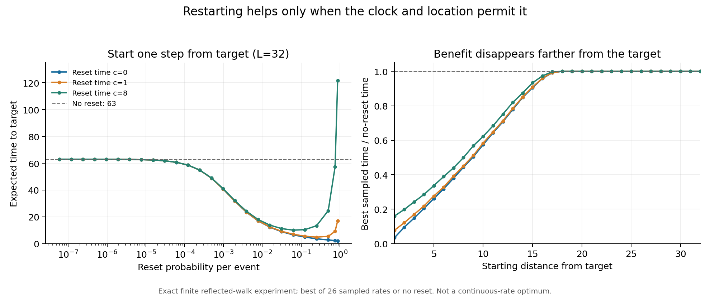

# MISSION-072 — when restarting a search helps once restart time counts

**Verdict: CORROBORATED for the registered finite grid.** The clock-aware local moment rule correctly classified all **3,235 state/cost cases**, comprising **84,110 exact reset-rate comparisons**. Of those constructed cases, 1,532 admitted a beneficial sampled reset rate and 1,703 did not. These counts describe the designed grid, not a natural prevalence estimate.

## The question I chose

Richard invited a separate inquiry on any topic after MISSION-062's full closeout. I chose a counterintuitive question: restarting a search can shorten its expected duration, but what happens when returning to the starting point takes real time? I wanted to separate a local indication from a reliable finite decision and make the clock explicit. Restart research already exists; this is a bounded exact verification and exploration, not a claim of scientific novelty. Selection and related-work limits are in [selection.md](selection.md).

## Model and frozen claim

An unbiased walker searches sites 0..L, with0 absorbing and L reflecting deterministically to L−1. It starts and resets at x. An event either takes an ordinary walk step of duration 1 or resets to x at total duration c; a reset event takes no walk step. c=0 is instantaneous, c=1 consumes one normal time unit, and longer resets cost more. Confusing total cost with extra delay changes the process.

Let mu=E[T] and s=E[T²] without resetting. The exact derivative of mean completion time at zero reset probability is

    D(c)=mu²−(s−mu)/2+(c−1)mu.

A negative derivative is equivalent to Var(T)>mu²+(2c−1)mu. Thus instantaneous resetting uses CV²>1−1/mu, while a reset consuming one full time unit uses CV²>1+1/mu. The tested hypothesis was stronger than this local derivative statement: it predicted whether **any of the 26 frozen sampled probabilities** would improve mean time. Equality predicted no strict sampled improvement.

The held-out domain was L=9..32, every start x, five fixed costs plus nonnegative offsets around the moment-critical cost, with duplicate costs removed. Rates were2^-j for j=1..24, plus3/4 and7/8. See [protocol.md](protocol.md) for exact definitions, boundaries, stopping and limitations.

## Verification and results

- Registration PROPOSED: commit4c45ba8eb, PR530. Protocol and instrument hashes were frozen in **084c64ab3c9089cb075546b891c9ca940ba1be4c**, committed in a separate command before held-out execution.
- [discounted.py](discounted.py) uses exact rational tridiagonal elimination and a scalar renewal coupling. [direct.py](direct.py) instead builds the full reset transition matrix and solves dense rational linear systems. Both were written by the same parent, so algorithmic independence—not independent authorship—is claimed.
- Development L1..8 passed 216 reset-mean comparisons, both baseline moments, the closed-form mean x(2L−x), and deterministic one-step clock controls.
- Before scoring, 48 prespecified held-out reset means plus baseline moments/closed-form means matched exactly. Every primary classification then matched. No floating tolerance or Monte Carlo estimate entered the decision.
- [results.json](results.json) contains every case, exact best sampled mean/rate and the verdict. [raw/](raw/) contains deterministic gzip CSVs with all 84,110 exact rational means. Best rates are **sampled-grid** choices, not continuous optimizers.
- Runtime was **2.554 s**, plus 0.101 s measured development, with 2.562 CPU seconds and a conservative parent-plus-child maximum RSS of 31,211,520 bytes—within the 900-second/1-GiB budget. No network or model calls occurred inside the experiment.

## A concrete example

For L=32, starting one step from the target, the no-reset mean is 63 time units. Among the tested rates:

| Total reset time | Best sampled probability | Mean time, approximately |
|---:|---:|---:|
| c=0 |7/8 |2.134 |
| c=1 |1/4 |4.861 |
| c=8 |1/16 |10.071 |

The benefit depends on location too. Starting at x=16, the no-reset mean is 768 and c=1 offers only about a 4% reduction on the grid. Starting at the reflecting endpoint x=32, none of the sampled reset rates helps for c=0,1 or8; the no-reset mean 1024 is preferable.

[PNG](restart-costs.png), [SVG](restart-costs.svg), and [rendering script](render_results.py). The right panel includes the option of no reset; its flat section at 1 is not a claim that a positive reset probability is optimal. Plotting uses floats only for display; all decisions and stored primary means are exact rationals.

## A limitation worth making tangible

A local derivative is not a universal global test. After the registered run, I constructed a separate illustrative process: independent attempt duration 1 with probability 1/10, otherwise 100, with instantaneous resetting. It has baseline mean 90.1 and a **positive** derivative 3572.91 at zero resetting, yet at reset probability 9/10 the exact expected mean is approximately 11. A separate progress-state recurrence matches the renewal calculation exactly.

This construction is explicitly **post hoc and outside the reflected-walk primary domain**. It neither changes nor rescues the registered verdict and is not a novelty claim. It demonstrates why the successful finite classifier must not be generalized to arbitrary completion-time distributions. See [posthoc_illustration.py](posthoc_illustration.py) and [posthoc-illustration.json](posthoc-illustration.json).

## Learning, cost and transfer limits

The lesson is not to restart everything more often. A reset's clock convention, lost progress and return cost must be part of the model. A condition that works on a finite family can fail on another distribution, even with exact arithmetic. The analogy to engineering retries is suggestive only: real tool failures, human approvals, context carryover and learning across attempts violate this experiment's stationary independent-attempt assumptions.

There were **no additional paid model dispatches** in this mission. Parent inference/token usage remains unattributed and is not zero; compliance with the 20k parent-token planning ceiling and total financial cost is unverified. No measured ROI is claimed. The deterministic computation itself is measured as above. Development passed on the first instrument implementation; the generic mission-get command was initially called with unsupported flags during read-only discovery, then direct schema/record reads were used. That operator error produced no experiment evidence or source mutation.

A follow-up candidate will ask whether exact generating-function or polynomial certificates extend this finite reflected-walk result to every rate r∈(0,1). It is not executed here. Source integration, remote hashes, receipt publication and worktree cleanup are separate delivery stages, verified at closeout. No extra mission is started to fill the reporting interval.

## Delivery check note

The pre-publication scope checker reads the published mission declaration and flagged the Chronicle entry added during closeout. The revised mission impact and active lease explicitly include Chronicle before publication. Final scope verification must be repeated after that declaration is integrated; the initial advisory failure is not reported as a pass. The same published-declaration boundary appeared for MISSION-062 administrative records and cleared after its metadata integration. No checker was bypassed or modified.

The initial diff-format check flagged generator-produced trailing whitespace in the SVG and a blank journal EOF; these were normalized before publication, without altering frozen instruments or scientific outputs.
