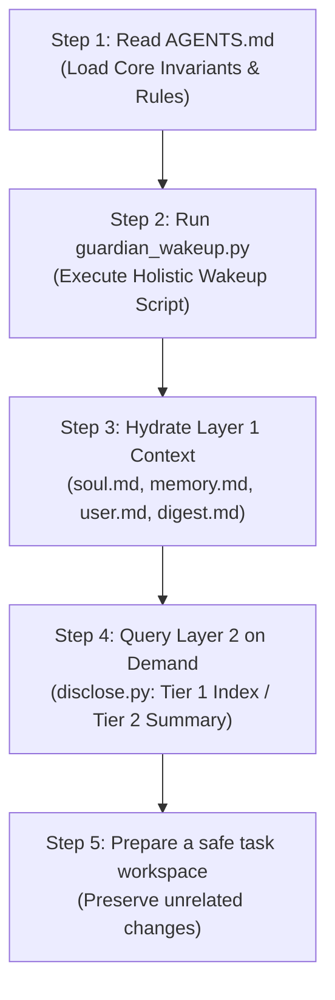

# Autonomous Agent Bootstrapping Reference (`bootstrapping.md`)

> **Protocol 128 Fast-Boot & Cognitive Orientation Architecture**  
> *Target Audience: Autonomous AI Agents (Claude, Gemini, Codex, Qwen) and CLI Orchestrators.*

---

## 1. Executive Purpose

Every session starts fresh without inherent long-term memory in the model weights. The Bootstrapping sequence eliminates stateless amnesia within 5 milliseconds, hydrating the agent with:
1. Constitutional invariants and the Human Gate law.
2. Fast-boot identity, human partner context, and recent architectural decisions.
3. Access paths to 3-tier progressive disclosure across Layer 2 sovereign knowledge.

---

## 2. Deterministic 5-Step Bootstrapping Sequence



### Step 1: Instruction Ingestion
- Read [`AGENTS.md`](file:///Users/richardfremmerlid/Projects/Project_Sanctuary/AGENTS.md) (or [`START_HERE.md`](file:///Users/richardfremmerlid/Projects/Project_Sanctuary/START_HERE.md) for human engineers).
- Apply the Human Gate in `.agent/rules/constitution.md`: state-changing operations require explicit approval ("Proceed", "Go", or "Execute"). Use existing authorization only within its stated scope; do not request repeat approval for steps it already covers.

### Step 2: Dynamic Holistic Wakeup & Local Model Readiness
Run the holistic wakeup script (read-only by default to respect the Human Gate):
```bash
python3 plugins/sanctuary-core/.apm/skills/operating-sanctuary-guardian/scripts/guardian_wakeup.py --mode HOLISTIC
# To optionally persist the briefing to disk: --write-digest
```
- Reads runtime context and verifies Layer 1 file health and git environment dynamically.
- Verifies local sovereign model readiness:
  - Check persistent MLX server endpoint: `curl -s http://127.0.0.1:8080/v1/models`
  - Or audit cached weights and engine readiness: `python3 plugins/sanctuary-core/.apm/skills/operating-sanctuary-guardian/scripts/forge_llm.py status`
- Validates every mission manifest in `LEARNING/missions/` against `LEARNING/missions/mission.schema.json` and reports one line (`PASS [N manifests valid]`, or `WARN` naming the first problems). A WARN never turns Layer 1 red or stops the boot; fix it before you commit, because the pre-commit gate enforces the same schema.
- Outputs structured JSON or formatted markdown (`--format markdown`).

### Step 3: Layer 1 Fast-Boot Hydration
Inspect the following files (total token load ~2,500 tokens):
- [`context/soul.md`](file:///Users/richardfremmerlid/Projects/Project_Sanctuary/context/soul.md): Guardian identity, prime directives, Anti-Asch epistemic principles.
- [`context/user.md`](file:///Users/richardfremmerlid/Projects/Project_Sanctuary/context/user.md): Human partner preferences (Richard), pair-programming protocol.
- [`context/memory.md`](file:///Users/richardfremmerlid/Projects/Project_Sanctuary/context/memory.md): Hot working memory, active decisions, asymmetric insights.
- [`.agent/learning/guardian_boot_digest.md`](file:///Users/richardfremmerlid/Projects/Project_Sanctuary/.agent/learning/guardian_boot_digest.md): Active task status and recent milestones.

### Step 4: Layer 2 Progressive Disclosure Retrieval
Start at `LEARNING/INDEX.md` (repository: LEARNING/INDEX.md): it says what each folder is for: the knowledge canon (`concepts/`, `procedures/`, `philosophy/`), the mission system at the root (`missions/`, `experiments/`, `index.jsonl`, `backlog.md`, `inbox.jsonl`), and the research dossiers (`research/`, each marked KEEP or HISTORICAL). Retired material is in `ARCHIVE/LEARNING_pre_2026-11/`.

When the task requires contextual knowledge, do not dump entire repositories or research directories. Use [`managing-sovereign-memory`](file:///Users/richardfremmerlid/Projects/Project_Sanctuary/plugins/sanctuary-core/.apm/skills/managing-sovereign-memory):
```bash
# Tier 1: High-level overview & concepts table
python3 plugins/sanctuary-core/.apm/skills/managing-sovereign-memory/scripts/disclose.py --tier 1

# Tier 2: Summary of a specific topic/concept
python3 plugins/sanctuary-core/.apm/skills/managing-sovereign-memory/scripts/disclose.py --tier 2 --path LEARNING/concepts/<file>.md

# Associative Wikilink Traversal
python3 plugins/sanctuary-core/.apm/skills/managing-sovereign-memory/scripts/query_graph.py --target <concept>
```

#### Mission manifests are schema-validated
Before you create or edit any `LEARNING/missions/MISSION-NNN.json`, read `LEARNING/missions/mission.schema.json` (required keys, status/verdict/surface/tier enums, ID patterns, score ranges; unknown extra keys are allowed). Then check your work:
```bash
python3 plugins/sanctuary-core/.apm/skills/managing-sovereign-memory/scripts/validate_missions.py   # structure only; exit 1 on any problem, and on an empty folder
python3 plugins/sanctuary-core/.apm/skills/managing-sovereign-memory/scripts/manage_backlog.py validate   # schema + score and projected_impact invariants
```
Details and how to change a rule: agent-native-backlog.md (`managing-sovereign-memory` skill: references/agent-native-backlog.md), "Manifest schema".

### Step 5: Git & Workspace Preparation
Inspect status, branches, worktrees and coordination state before editing. Reuse a valid task-owned feature worktree, or create one from a verified committed base through the supported coordination workflow. A dirty main checkout alone is not a blocker: leave unrelated edits untouched, and do not stash, discard, commit or copy them. Never commit directly to `main`; push or merge only under authorization that covers those actions. Confirm local machine harnesses (`.agents/`, `.claude/`, `.codex/`) are gitignored and only `.agent/` is tracked. After safe setup, continue the requested task; an intermediate command or progress update is not completion. Stop when the deliverable is verified, the user pauses, or a concrete blocker prevents further authorized work.


## Appendix: Two-repository skill maintenance (MISSION-055)

Skills live in two places: `plugins/sanctuary-core/` (Sanctuary policy and adapters) and the companion `richfrem/agent-plugins-skills` (generic orchestration, `cli-agent`, shared evaluation `evaluating-agent-outcomes`), installed globally by APM. You are responsible for both: place changes by ownership, merge the companion first, refresh installs and verify them, then update the consumer, and update the root documents and every skill that points at a moved capability. See Protocol 133 section 8 and `evaluating-agent-work/references/shared-loop-adapter.md`. Never hand-edit installed copies.

Completion wiring: `record-result` durably marks the final manifest for preservation; after publishing sources to `origin/main`, `merge_prep.py regenerate` runs incremental local extraction, schema and coverage checks. Startup reports preservation status without changing preservation files. Capture and recovery occur at mission/session closure (`soul_coverage.py closure`) or an explicitly requested recovery action. Pending/failed/local-complete status is separate from the scientific verdict. Commit the export separately, then sync remotely only with authorization. See the coverage contract (`coverage.md` in the `preserving-soul-traces` skill).
